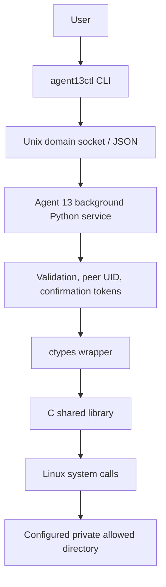
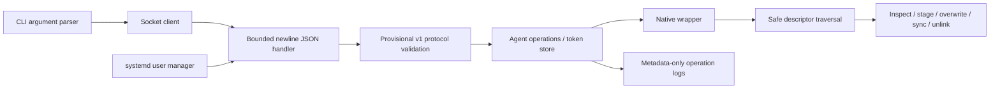
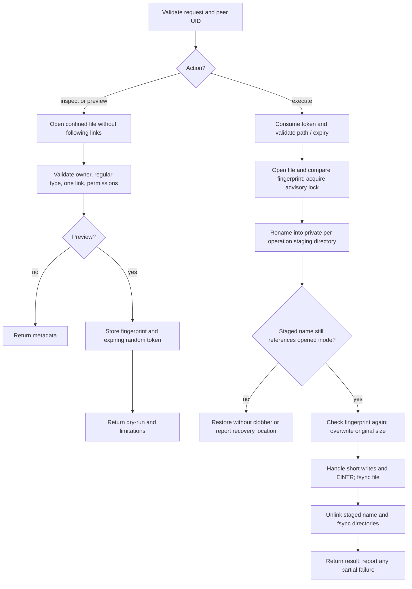
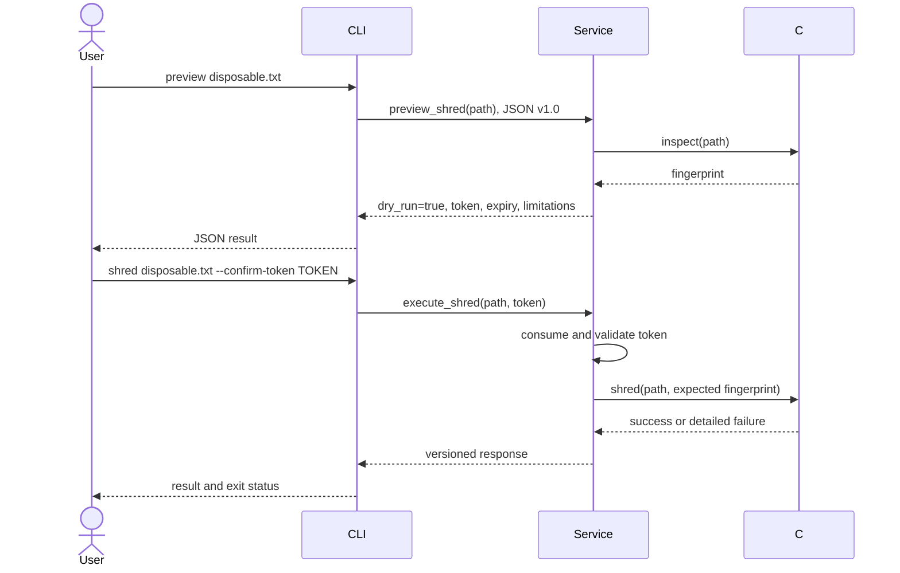
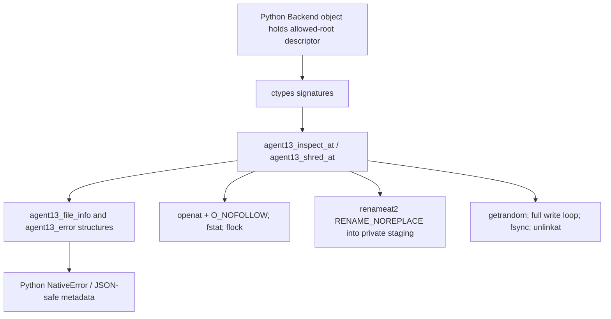
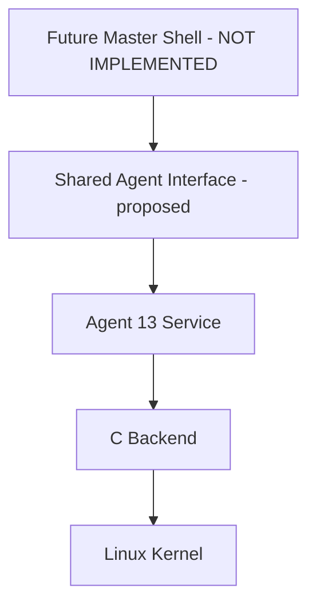

# Agent 13 architecture

This design precedes application code. Only standalone Phase A is implemented.

## 1. Current standalone architecture



```text
User -> CLI -> Unix socket -> Service -> Validation -> ctypes
                                                       |
Filesystem <- Linux kernel <- C shared library <--------+
```

## 2. Internal component/block diagram



## 3. Secure shredding flowchart



Any validation failure returns an error before intentional data overwrite.
The source name may disappear during execution before overwrite completes.
On failure the service attempts a no-clobber restore; otherwise it reports
the private recovery path. A successful overwrite does not prove physical
erasure. Advisory locking cannot prevent an uncooperative open-file writer.

## 4. CLI-to-service sequence



## 5. Python-C interaction



The C header is the ABI source of truth. Python retains an open descriptor to
the allowed root, avoiding a later replacement of its pathname. C rechecks
ownership and mode. Relative path components are opened one at a time.

## 6. Future integration (NOT IMPLEMENTED)



```text
Future Master Shell [NOT IMPLEMENTED]
       |
Shared Agent Interface [PROPOSED]
       |
Agent 13 Service
       |
C Backend
       |
Linux Kernel
```

No master process, registry, LLM, or dispatcher is needed to run this agent.
